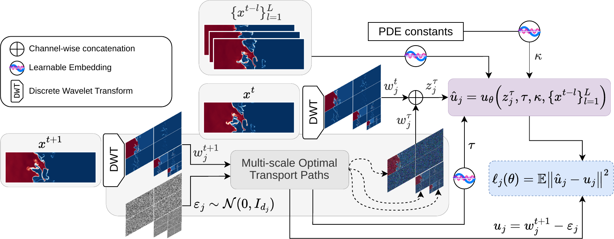

<div align="center">

# Wavelet Flow Matching for Multi-Scale Physics Emulation

**NeurIPS 2026**

Gabriele Accarino · Juan Nathaniel · Carla Roesch · Pierre Gentine · Sara Shamekh · Duncan Watson-Parris · Viviana Acquaviva

[**Project page**](https://gabrieleaccarino.github.io/wavelet_flow_matching/) ·
[**Paper**](#) <!-- TODO: paper link --> ·
[**arXiv**](#) <!-- TODO: arXiv link --> ·
[**Pre-trained weights**](#) <!-- TODO: weights link --> ·
[**BibTeX**](#citation)



</div>

---

**Wavelet Flow Matching (WFM)** is a generative emulator for multi-scale PDE dynamics. Instead of learning a latent compression, WFM performs optimal-transport conditional flow matching **directly on the multi-scale wavelet coefficients** of the next state. The discrete wavelet transform is prescribed, lossless and needs no training; a single U-Net, whose encoder–decoder hierarchy mirrors the wavelet scales, predicts coupled transport velocities for every scale at once. A single inverse transform at the end of sampling returns the physical field.

On three chaotic systems from [The Well](https://polymathic-ai.org/the_well/) (Turbulent Radiative Layer 2D,
Rayleigh–Bénard convection and Active Matter), WFM achieves the best spectral coherence among generative baselines, competitive or better long-horizon accuracy, and samples **1.1–1.5× faster** than pixel-space flow matching.

## Contents

- [Installation](#installation)
- [Data](#data)
- [Quick start](#quick-start)
- [Training](#training)
- [Inference and evaluation](#inference-and-evaluation)
- [Reproducing the paper tables and figures](#reproducing-the-paper-tables-and-figures)
- [Repository layout](#repository-layout)
- [Project page](#project-page)
- [Citation](#citation)
- [Acknowledgements](#acknowledgements)

## Installation

The environment used for the paper is pinned in [`env/`](env/): `environment.yml` (conda) and `requirements.txt` (pip).
All experiments were run with Python 3.10.15 and PyTorch 2.6.0 (CUDA 12.4, cuDNN 9.2, NCCL 2.21) on NCAR Derecho
GPU nodes (4× NVIDIA A100 40GB per node, SUSE Linux 15).

**Option A — conda (recommended)**

```bash
git clone https://github.com/gabrieleaccarino/wavelet_flow_matching.git
cd wavelet_flow_matching

conda env create -f env/environment.yml      # Python + pinned dependencies
conda activate wfm
pip install -e .                             # the wavelet_flow_matching package itself
```

**Option B — pip / venv**

```bash
python -m venv .venv && source .venv/bin/activate   # same Python version as in env/environment.yml
pip install -r env/requirements.txt
pip install -e .
```

`env/requirements.txt` pins `torch` to the version used in the paper. If the default PyPI wheel does not match your
CUDA driver, install PyTorch first following <https://pytorch.org/get-started/locally/>, then run the commands above.
`pip install -e .` alone also works and pulls the latest compatible versions instead of the pinned ones.

The analysis code (`wavelet_flow_matching.analysis`) only needs `numpy`, `pandas` and `pyyaml`, so the paper tables
can be rebuilt without a GPU or PyTorch.

## Data

All experiments use datasets from [The Well](https://github.com/PolymathicAI/the_well). Download them with the
`the_well` CLI, e.g.:

```bash
the-well-download --base-path ./data/datasets --dataset turbulent_radiative_layer_2D
the-well-download --base-path ./data/datasets --dataset rayleigh_benard
the-well-download --base-path ./data/datasets --dataset active_matter
```

| System | Resolution | Channels | Trajectories | Steps | Scalar constants $\kappa$ |
|---|---|---|---|---|---|
| Turbulent Radiative Layer 2D | 384×128 | 4 | 90 | 101 | $t_{\mathrm{cool}}$ |
| Rayleigh–Bénard | 512×128 | 4 | 1750 | 200 | $Ra$, $Pr$ |
| Active Matter | 256×256 | 11 | 225 | 81 | $\alpha$, $\zeta$ |

## Quick start

### Multi-scale wavelet transform

```python
import torch
from wavelet_flow_matching.wavelets import WaveletDecomposer2D

dwt = WaveletDecomposer2D(wavelet="db4", n_scales=3, mode="periodic")

x = torch.randn(2, 4, 1, 128, 384)          # (B, C, T, H, W)
coeffs = dwt.forward_transform(x)           # {scale: (B, C, T, 4, H_j, W_j)}, fine to coarse
x_rec = dwt.inverse_transform(coeffs)       # exact reconstruction

print({j: tuple(c.shape) for j, c in coeffs.items()})
print("max reconstruction error:", (x - x_rec).abs().max().item())
```

### Autoregressive rollout from a pre-trained checkpoint

```python
import torch
from wavelet_flow_matching.utils.well_data import get_well_dataset, get_well_inputs
from wavelet_flow_matching.modules.wavelet_fm import WaveletFlowModule

device = torch.device("cuda" if torch.cuda.is_available() else "cpu")

model = WaveletFlowModule.from_checkpoint("path/to/WaveletFlow_..._portable.ckpt", map_location=device)
model.eval().to(device)

dataset = get_well_dataset(
    path="./data/datasets", physics="turbulent_radiative_layer_2D",
    split="test", steps=-1, transform=["log_scalars"], augment=[],
)

N_STEPS_INPUT, N_ENSEMBLE = 4, 8                                                # 4-frame context, M = 8 ensemble members
x_full, label = get_well_inputs(dataset[0], device=device)                      # (T, H, W, C), (num_cond,)
seed = x_full[:N_STEPS_INPUT].unsqueeze(0).expand(N_ENSEMBLE, -1, -1, -1, -1)
cond = label.unsqueeze(0).expand(N_ENSEMBLE, -1) if label is not None else None

with torch.inference_mode():
    _, preds = model.rollout(
        seed=seed, scalar_conds=cond,
        rollout_steps=x_full.shape[0] - N_STEPS_INPUT,
        n_ensemble=1,                                  # ensemble is carried by the batch dimension
    )
# preds: (B, E, rollout_steps, H, W, C) in physical units
```

A complete, runnable version is in [`notebooks/examples/rollout_wavelet_fm.ipynb`](notebooks/examples/rollout_wavelet_fm.ipynb);
baselines are rolled out in [`notebooks/examples/rollout_baselines.ipynb`](notebooks/examples/rollout_baselines.ipynb).

## Training

Each model is fully specified by a TOML config in `configs/<pde>/`. Config names encode the model, the number of
wavelet scales and the mother wavelet, e.g. `WaveletFlow_rayleigh_benard_3scales_db4_ablation_v4.0.toml`.

```bash
# WFM (single node, 4 GPUs)
torchrun --nproc_per_node=4 wavelet_flow_matching/train_wavelet_fm.py \
    -c configs/turbulent_radiative_layer_2D/WaveletFlow_turbulent_radiative_layer_2D_3scales_haar_ablation_v4.0.toml \
    -n 1 -d 4
```

Baselines use the analogous entry points `train_fourier_fm.py` (FM<sub>pixel</sub> / FM<sub>fourier</sub>),
`train_latent_fm.py` (LatentFM) and `train_neural_ops.py` (FNO, TFNO, WNO). PBS job scripts used on NCAR Derecho
are in `scripts/train_<pde>.sh`.

Selected mother wavelets (lowest average spectral coherence RMSE):

| | TRL 2D | Rayleigh–Bénard | Active Matter |
|---|---|---|---|
| WFM 1-scale | haar | db4 | haar |
| WFM 3-scale | haar | db4 | db2 |

## Inference and evaluation

Ensemble rollouts and metrics (VRMSE, CRPS, spectral coherence RMSE, physics diagnostics) are produced from a YAML
config:

```bash
python wavelet_flow_matching/inference_wavelet_fm.py \
    --config configs/turbulent_radiative_layer_2D/inference_turbulent_radiative_layer_2D_seed.yaml \
    --override n_ensemble=8 seed=42
```

`n_ensemble` is the number of **ensemble members** $M$: independent realizations generated from the same initial
condition, each starting from its own Gaussian noise draw ($M = 8$ in the paper). At inference the members are split
across GPUs. In the training configs, `n_ensemble = 1` only controls the end-of-epoch monitoring sample and does not
affect training. The name is kept for compatibility with the released configs and checkpoints.

This writes `experiments/<pde>/metrics/*_metrics.csv` (one per inference seed) and `*_perf.yaml` (profiling).
Initial-condition perturbation runs use `inference_wavelet_fm_ic_pert.py` (`scripts/inference_ic_pert.pbs`).

## Reproducing the paper tables and figures

Run `notebooks/01_tables.ipynb` top to bottom: one cell per paper table, each writing
`artifacts/tables/tex/<name>.tex` and `csv/<name>.csv` (needs only numpy, pandas and pyyaml). Without Jupyter:

```bash
python -c "from wavelet_flow_matching.analysis import paper_tables as P; P.build_all()"
```

Set `WAVELET_FLOW_MATCHING_ROOT=/path/to/checkout` if `experiments/` lives elsewhere.

**Metric files.** `experiments/<pde>/metrics/<model>_..._seed{42,84,168}_<pde>_metrics.csv` (one per inference
seed; all WFM variants and generative baselines) and `<model>_..._<pde>_stats.csv` (single run; deterministic
baselines FNO/TFNO/WNO).

**Aggregation.** Within a seed: mean over trajectories, fields and lead times; across seeds: mean ± sample std.
Spectral coherence "averaged over the rollout" is horizon-balanced (mean of the three horizon means); the
physical-parameter tables average over all lead times. Horizon bins are inclusive (e.g. RB: 1–32, 33–64, 65–196).

| Notebook | Produces |
|---|---|
| `01_tables.ipynb` | every table of the paper → `artifacts/tables/` |
| `02_figures.ipynb` | metric figures (Fig. 3, S2–S4) → `artifacts/figures/` |
| `03_qualitative_rollouts.ipynb` | rollout snapshots (Fig. 2, S5) → `artifacts/figures/` |
| `04_kinetic_energy.ipynb` | kinetic-energy diagnostic |
| `05_cross_scale_coupling.ipynb` | cross-scale sensitivity (needs GPU + checkpoint) |
| `06_architecture_figure.ipynb` | Fig. 1 panels |
| `07_rollout_animations.ipynb` | rollout GIFs → `artifacts/gifs/` |

## Repository layout

```
wavelet_flow_matching/            package
  wavelets/             DWT2D: batched multi-scale 2D DWT / IDWT (PyWavelets backend)
  models/               WaveletFlowUNet (velocity network), DC-AE wrapper
  modules/              Lightning modules: wavelet_fm, fourier_fm, latent_fm, neural_ops
  utils/                data loading (The Well), rollout, metrics, physics diagnostics, GIF animations
  train_*.py, inference_*.py, eval_only.py   entry points
  analysis/             numpy/pandas only — rebuilds every table of the paper
configs/<pde>/          training configs (TOML) + inference configs (YAML, *_seed.yaml = 3-seed runs)
scripts/                PBS job scripts (training, inference, IC-perturbation runs)
env/                    pinned environment: environment.yml (conda), requirements.txt (pip)
notebooks/              tables, figures, rollout snapshots and animations, examples, data preparation
artifacts/              tables and figures that go into the paper (tracked in git)
docs/                   project page (GitHub Pages)
experiments/<pde>/      (not in git) checkpoints, metrics, profiling
```

## Citation

```bibtex
@inproceedings{accarino2026wfm,
  title     = {Wavelet Flow Matching for Multi-Scale Physics Emulation},
  author    = {Accarino, Gabriele and Nathaniel, Juan and Roesch, Carla and
               Gentine, Pierre and Shamekh, Sara and Watson-Parris, Duncan and
               Acquaviva, Viviana},
  booktitle = {Advances in Neural Information Processing Systems},
  year      = {2026}
}
```

## Acknowledgements

We acknowledge funding from NSF through the Learning the Earth with Artificial intelligence and Physics (LEAP)
Science and Technology Center (Award #2019625). VA acknowledges support from a PIVOT Research award (Award #12871)
from the Simons Foundation. This work used NSF NCAR Derecho-GPU through allocation CIS251353 from the
[ACCESS](https://access-ci.org) program, supported by U.S. National Science Foundation grants #2138259, #2138286,
#2138307, #2137603 and #2138296.

We thank the authors of [The Well](https://github.com/PolymathicAI/the_well) for the datasets and baseline
configurations, [PyWavelets](https://github.com/PyWavelets/pywt) for the wavelet backend, and
Rozet et al. (*Lost in Latent Space*) for the pre-trained autoencoder used by the latent baseline.

## Contact

Gabriele Accarino — ga2673@columbia.edu
